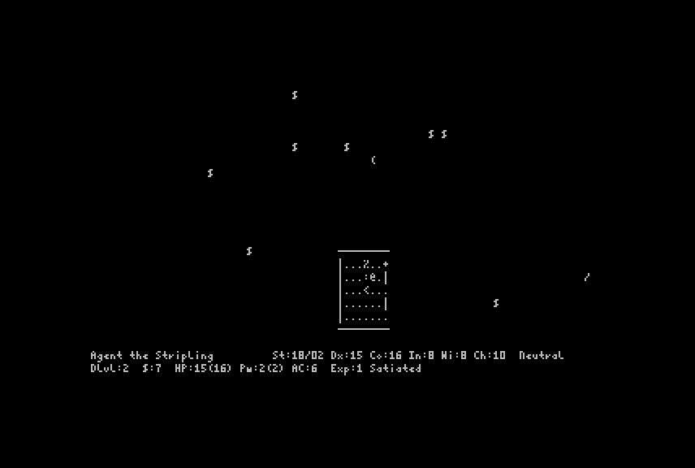

# NetHack-C64

NetHack 3.4.3, the real thing, compiled for the Commodore 64.
A long-term labour of love by Jolyon, built with Claude Code and Codex.

**Targets:** the whole game runs first on a **C128 + Magic Desk 128 cartridge + REU** (VICE's
x128), then gets squeezed onto the **C64 + EasyFlash + REU** (VICE, the Ultimate family,
C64 Ultimate). Stock C64 is the white whale (ADR-0003, amended 2026-11-21).

## Where it stands (2026-11-26)

**NetHack plays on the C128.** The whole of NetHack 3.4.3, compiled from its own C, runs in
x128 on a Magic Desk 128 cartridge with a 4 MB REU:



These have been played on it in VICE:
- character creation and Dlvl 1;
- walking, running, fighting and kills;
- eating, throwing, kicking, `#force` and `#loot`;
- reading, quaffing, engraving with and zapping a wand;
- praying;
- going down to Dlvl 2 and back up, with the old level restored as it was left;
- saving and restoring.

The C128's keypad and a joystick in port 2 move the hero; the stick still has to be tried on
real hardware or with a real stick in VICE. Each game starts the same for now (the clock is
fixed), so a recorded game replays key for key: that is how each new build is checked. Next
is longer play: deeper levels, shops, the special levels.

How it fits (the C128 build, fc52):

| | |
|---|---|
| Game code, Oscar64 `-Os` | ≈ 1.2 MB, 108 / 108 source files compile |
| Code placement | 137 banks of 16 KB: 63 on the cartridge, 74 copied in from the REU (ADR-0008) |
| Large data (monsters, objects, the heap) | far spaces in the REU, through typed far pointers added to the compiler (ADR-0009) |
| Shared strings and `char` arrays | far characters in the C128's RAM bank 1, `$C100-$FBFF` (ADR-0010) |
| Near heap | 2,808 bytes (fc52); on fc50, 1,588 of its 2,832 in use on Dlvl 2 |
| Linking the whole game | one Oscar64 run, peak 13.7 GB of RAM, so it runs on a desktop |

**The compiler.** Oscar64 is pinned at v1.32.273 plus 99 commits of fixes and features
(ADR-0007, `tools/oscar64-upstream/patches/pin/`). The far-data support is 22 more commits on
top (`patches/far-spaces/`). Each compiler bug found has a minimal repro: there are 92 in
`tests/oscar64-repros/`, catalogued in `docs/OSCAR64-COMPAT.md`. Nothing goes upstream until
the port is done.

**Still to come.**
- The rest of the game in play: special levels, the Mines, Sokoban, the quest, shops.
- Speed. Since 2026-11-27 the game runs at 2 MHz, and the port's own code (the RAM disk, the
  heap) is on cartridge banks instead of REU banks it had to be copied from, 16 KB at a time:
  start-up takes 2.6 s instead of 15.4, the first level 29 s instead of 81 at 1 MHz
  (`docs/data/speed-c128-2026-11-27.txt`). Next is play itself, where most bank loads now are.
- A real clock and seed (the decision is open in `docs/TO-DECIDE.md`), and
  persistence to disk.
- Then the C64, with about 12 KB less near memory than the C128 has (ADR-0003). The C64 platform build
  (`make`) and its self-tests stay working throughout.

Plan: [docs/PLAN.md](docs/PLAN.md) · next tasks: [docs/TASKS.md](docs/TASKS.md) ·
latest session: [docs/sessions/](docs/sessions/) · open questions:
[docs/TO-DECIDE.md](docs/TO-DECIDE.md).

## Quick start

```sh
tools/setup-arch.sh            # or tools/setup-ubuntu.sh
export PATH=$HOME/.local/bin:$PATH
make                           # the C64 platform build -> build/nethack-ef.crt
make prg128                    # the C128 platform build -> build/nethack128.prg
make test                      # 6 headless VICE self-tests (C64 prg/EF x REU sizes, C128)
make run                       # the platform demo in VICE (hjklyubn, s/c/r = REU stash/clear/restore)
make port-tree                 # NetHack source -> port/ (ANSI, Oscar64-normalised)
tools/host-build.sh && tests/host_smoke.py   # port/ still plays as Linux NetHack
```

`make`, `make prg128` and `make test` build the hardware layer and its self-tests, not
the game. The whole game is linked by `tools/bank/build_c64.py --target c128` with the
far-spaces compiler. It needs a machine with more than 16 GB of RAM; see T2.13 in
`docs/TASKS.md`.

## Map

```
AGENTS.md / CLAUDE.md   instructions for Codex / Claude Code
src/                    platform code (Oscar64)   src/hal/ = hardware layer (C64 + C128)
port/                   the NetHack source we change   port/sys/c64/ = our system and window port
tools/                  vice.py (drive VICE), bank/ (bank planner and whole-game build),
                        oscar64-upstream/ (the pinned compiler's patches), measure/,
                        kr2ansi.py, oscar_normalize.py, setup scripts
tests/                  run_selftests.py (VICE), oscar64-repros/, host_smoke.py, spikes/
upstream/               pristine NetHack 3.4.3 tarball (read-only)
docs/                   PLAN, TASKS, TO-DECIDE, ARCHITECTURE, HARDWARE, OSCAR64-COMPAT,
                        BANKING-SPIKE, RAM-PLAN, NETHACK-SURVEY, TOOLCHAIN, VICE-AUTOMATION,
                        AGENT-WORKFLOW, FEATURES, decisions/ (ADRs), sessions/ (handoff notes), data/
```

## Licence

Our own code (src/, tools/, tests/, docs/): choose before publishing (MIT
suggested). NetHack and everything derived from it (port/, cartridge
images) is under the NetHack General Public License — see `upstream/README.md`.
The 4x8 font in `tools/mkfont4x8.py` is original to this project.
