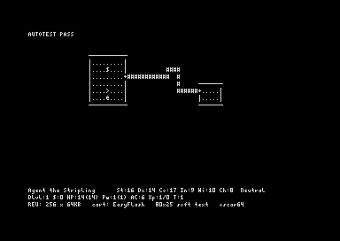

# NetHack-C64

NetHack 3.4.3, the real thing, compiled for the Commodore 64.
A long-term labour of love by Jolyon, built with Claude Code and Codex.

**Primary target:** C64 + EasyFlash cartridge + REU (VICE, Ultimate II+/Ultimate 64/
C64 Ultimate). Fallbacks: C128, then stock C64 as the white whale.

## Where it stands

Phase 0 is done (2026-11-08): the platform boots from an EasyFlash image,
draws NetHack's 80-column screen in software, detects and uses an REU, and is
driven headlessly by agents. The NetHack source is converted to ANSI C and
partially compiles with Oscar64. The numbers that shape everything else:

| | |
|---|---|
| Game code, Oscar64 `-Os` (estimate) | ~0.85 MB |
| All static content (code + text + levels) | ~1.7 MB, vs 1 MB EasyFlash |
| RAM needed while playing | ~45-60 KB, vs 30 KB resident |
| Files compiling under Oscar64, ADR-0007 compiler (C64 config, 2026-11-14) | 45 / 107 |



Details: [docs/NETHACK-SURVEY.md](docs/NETHACK-SURVEY.md) ·
plan: [docs/PLAN.md](docs/PLAN.md) · next tasks: [docs/TASKS.md](docs/TASKS.md).

## Quick start

```sh
tools/setup-arch.sh            # or tools/setup-ubuntu.sh
export PATH=$HOME/.local/bin:$PATH
make                           # build/nethack-ef.crt
make test                      # 5 headless VICE self-tests
make run                       # play with the Phase 0 demo in VICE (hjklyubn, s/c/r = REU stash/clear/restore)
make port-tree                 # NetHack source -> port/ (ANSI, Oscar64-normalised)
```

## Map

```
AGENTS.md / CLAUDE.md   instructions for Codex / Claude Code
src/                    C64 platform code (Oscar64)   src/hal/ = hardware layer
tools/                  vice.py (drive VICE), kr2ansi.py, oscar_normalize.py,
                        measure/, setup scripts, crtinfo.py, memmap.py, mkfont4x8.py
tests/                  run_selftests.py (VICE), oscar64-repros/, host_smoke.py
upstream/               pristine NetHack 3.4.3 tarball (read-only)
port/                   the NetHack source we change (created by `make port-tree`)
docs/                   PLAN, ARCHITECTURE, HARDWARE, OSCAR64-COMPAT, NETHACK-SURVEY,
                        TOOLCHAIN, VICE-AUTOMATION, AGENT-WORKFLOW, FEATURES,
                        decisions/ (ADRs), sessions/ (handoff notes), data/
```

## Licence

Our own code (src/, tools/, tests/, docs/): choose before publishing (MIT
suggested). NetHack and everything derived from it (port/, cartridge
images) is under the NetHack General Public License — see `upstream/README.md`.
The 4x8 font in `tools/mkfont4x8.py` is original to this project.
